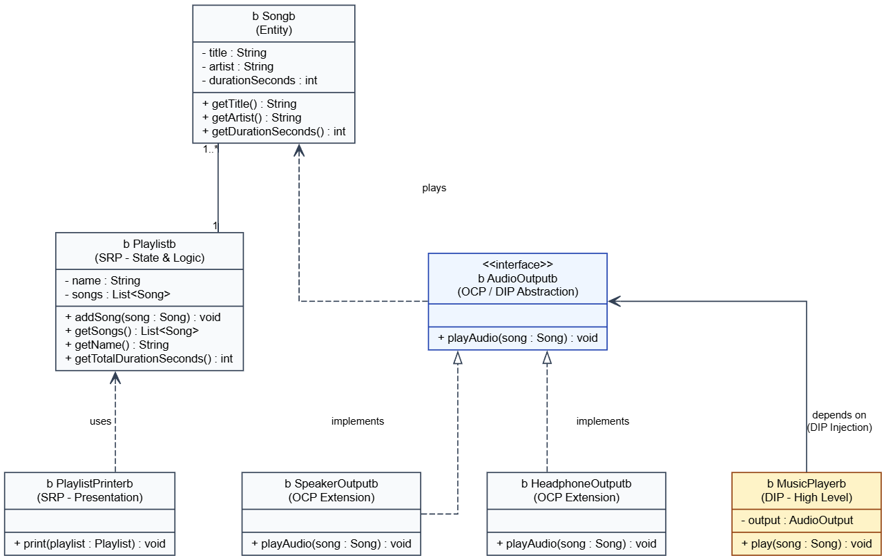

# TMPS Laboratory 0: SOLID Principles Implementation

## 1. Project Overview

This project is a lightweight **Music Player & Playlist Management System** written in Java. It models the core operations of a digital music client:

* Defining tracks with metadata (`title`, `artist`, `duration`).
* Organizing tracks into collections (`Playlist`) and calculating aggregate statistics.
* Directing playback across distinct output targets (e.g., headphones, speakers).

The design strictly implements three fundamental SOLID design principles:

* **S** — Single Responsibility Principle (SRP)
* **O** — Open/Closed Principle (OCP)
* **D** — Dependency Inversion Principle (DIP)

---

## 2. Project Architecture & File Structure

```text
tmps/
├── Song.java                 // Data entity representing a musical track
├── Playlist.java             // Domain collection for managing songs
├── PlaylistPrinter.java      // Console presentation service
├── AudioOutput.java          // Playback abstraction contract
├── SpeakerOutput.java        // Concrete loudspeaker output implementation
├── HeadphoneOutput.java      // Concrete private listening output implementation
├── MusicPlayer.java          // High-level client controller executing playback
├── Main.java                 // Application bootstrap and dependency composition root
└── uml_diagram.png           // UML Architecture Diagram
```

---

## 3. UML Class Diagram



### Architectural Relationships in the Diagram:
* **SRP Separation:** `Playlist` aggregates `Song` objects (`1` to `1..*`), while `PlaylistPrinter` has a loose usage dependency (`uses`) on `Playlist`.
* **OCP Abstraction:** `AudioOutput` acts as the interface contract. Concrete classes `SpeakerOutput` and `HeadphoneOutput` realize (`implements`) this contract.
* **DIP Inversion:** High-level controller `MusicPlayer` points directly to the `AudioOutput` interface (`depends on`) rather than coupling to any concrete loudspeaker or headphone class.

---

## 4. SOLID Principles Implementation

### 4.1 Single Responsibility Principle (SRP)

> **Rule:** A class should have one, and only one, reason to change.

#### Problem Without SRP
If formatting and display logic were bundled directly inside the `Playlist` class (e.g., adding a `printPlaylist()` method that outputs formatted text), the class would have two distinct responsibilities:
1. Business logic (managing the list of songs and aggregating duration).
2. Presentation logic (formatting and printing text to the console).

Any modification to UI requirements (e.g., switching to JSON or HTML output) would require editing and re-testing domain logic.

#### Implementation in Project
* **`Playlist.java`** is restricted exclusively to data operations: adding tracks and calculating total playback seconds.
* **`PlaylistPrinter.java`** handles presentation. It takes an unmodifiable view of a `Playlist` and formats the output for the console.

```java
// Playlist.java (Domain State Only)
public class Playlist {
    private final String name;
    private final List<Song> songs = new ArrayList<>();

    public void addSong(Song song) { songs.add(song); }
    public List<Song> getSongs() { return Collections.unmodifiableList(songs); }
    public int getTotalDurationSeconds() {
        int total = 0;
        for (Song song : songs) {
            total += song.getDurationSeconds();
        }
        return total;
    }
}

// PlaylistPrinter.java (Presentation Only)
public class PlaylistPrinter {
    public void print(Playlist playlist) {
        System.out.println("=== PLAYLIST: " + playlist.getName() + " ===");
        for (Song s : playlist.getSongs()) {
            System.out.printf("- %s by %s (%d sec)%n", s.getTitle(), s.getArtist(), s.getDurationSeconds());
        }
        System.out.println("Total Duration: " + playlist.getTotalDurationSeconds() + " seconds\n");
    }
}
```

---

### 4.2 Open/Closed Principle (OCP)

> **Rule:** Software entities should be open for extension, but closed for modification.

#### Problem Without OCP
Without an abstraction layer, handling multiple playback targets would require conditional control structures (e.g., `if (type.equals("speaker")) ... else if ...`) within the player. Introducing a new output type would mean modifying existing, tested code paths, risking regressions.

#### Implementation in Project
* The system introduces an interface: **`AudioOutput.java`**.
* Existing outputs (`SpeakerOutput`, `HeadphoneOutput`) implement this contract.
* If a new output is required (such as `BluetoothOutput` or `CarAudioOutput`), a new class implements `AudioOutput` without modifying a single line of code in `MusicPlayer` or `Main`.

```java
// AudioOutput.java (Contract)
public interface AudioOutput {
    void playAudio(Song song);
}

// SpeakerOutput.java (Extension 1)
public class SpeakerOutput implements AudioOutput {
    @Override
    public void playAudio(Song song) {
        System.out.println("[SPEAKER] Playing aloud: " + song.getTitle() + " by " + song.getArtist());
    }
}

// HeadphoneOutput.java (Extension 2)
public class HeadphoneOutput implements AudioOutput {
    @Override
    public void playAudio(Song song) {
        System.out.println("[HEADPHONES] Playing privately: " + song.getTitle() + " by " + song.getArtist());
    }
}
```

---

### 4.3 Dependency Inversion Principle (DIP)

> **Rule:** High-level modules should not depend on low-level modules. Both should depend on abstractions.

#### Problem Without DIP
If the high-level controller `MusicPlayer` directly instantiated a concrete device (e.g., `private SpeakerOutput output = new SpeakerOutput();`), it would be tightly coupled to that specific device. It could not easily be tested with mock objects or switched to headphones without modifying its internals.

#### Implementation in Project
* **`MusicPlayer.java`** depends solely on the **`AudioOutput`** interface.
* The concrete dependency is provided from the outside via constructor injection.

```java
// MusicPlayer.java (High-level module depending on abstraction)
public class MusicPlayer {
    private final AudioOutput output;

    // Injected via constructor
    public MusicPlayer(AudioOutput output) {
        this.output = output;
    }

    public void play(Song song) {
        output.playAudio(song);
    }
}
```

---

## 5. Execution & Sample Output

### 5.1 Running the Application

Compile and run the program from the `tmps` directory:

```bash
javac *.java
java Main
```

### 5.2 Terminal Output

```text
=== PLAYLIST: Favorites ===
- Careless Whisper by George Michael (300 sec)
- Take Five by Dave Brubeck (324 sec)
Total Duration: 624 seconds
=====================================

[HEADPHONES] Playing privately: Careless Whisper by George Michael
[SPEAKER] Playing aloud: Careless Whisper by George Michael
```

---

## 6. Summary of Benefits

| Principle | Applied Mechanism | Engineering Benefit |
| :--- | :--- | :--- |
| **SRP** | Separated `Playlist` (state) from `PlaylistPrinter` (view). | UI changes do not impact or risk breaking core playlist business logic. |
| **OCP** | Created polymorphic contract `AudioOutput`. | New playback destinations can be added by creating new classes without altering existing code. |
| **DIP** | Injected `AudioOutput` abstraction into `MusicPlayer`. | Lowers coupling, simplifies unit testing via mocks, and allows dynamic runtime switching of playback devices. |