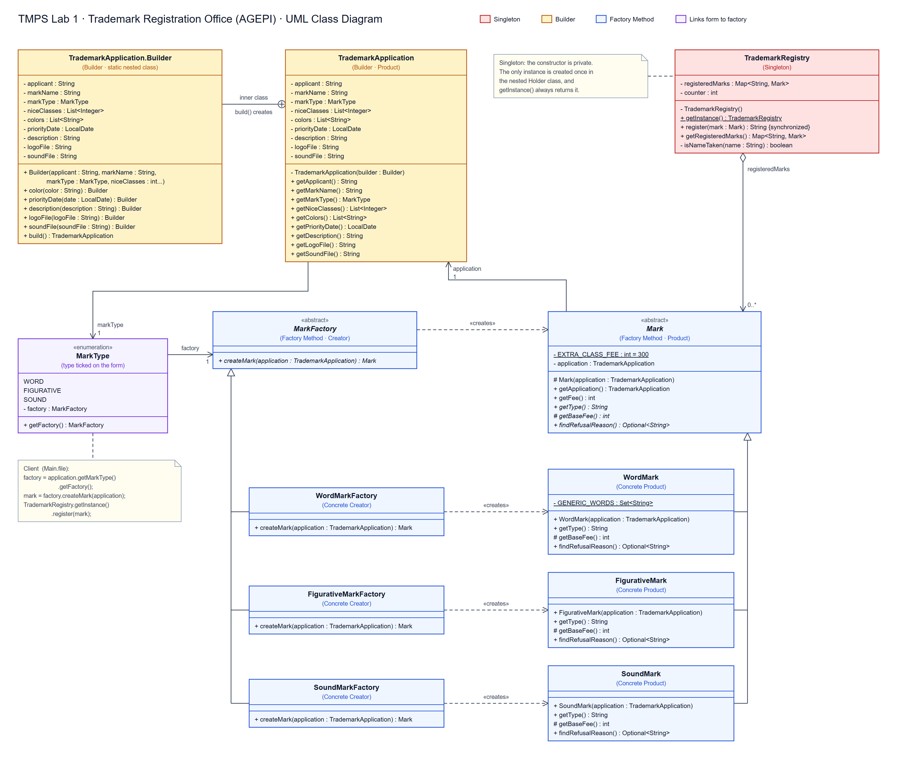

# TMPS Laboratory 1: Creational Design Patterns

## 1. Project Overview

This project is a small **Trademark Registration Office** written in Java, inspired by a national intellectual property agency such as AGEPI. It models how a company protects a brand:

* A company fills in a **trademark application** (applicant, mark name, type of mark, Nice classes, colors, logo, etc.).
* Based on the type ticked on the form (word, figurative or sound), the application goes to the matching factory, which creates that kind of **mark** with its own fee and examination rule.
* The mark is examined and, if accepted, entered into the **national trademark register** with a unique number such as `MD-2026-0001`.

The design implements three creational design patterns:

* **Singleton**: `TrademarkRegistry`
* **Builder**: `TrademarkApplication.Builder`
* **Factory Method**: `MarkFactory` and its subclasses

---

## 2. Project Architecture & File Structure

```text
lab1/
├── TrademarkApplication.java    // Application data + nested Builder          (Builder)
├── MarkType.java                // Type ticked on the form; links to a factory
├── Mark.java                    // Abstract product: fee + examination rule    (Factory Method - Product)
├── WordMark.java                // Text-only mark, refuses generic words       (Concrete Product)
├── FigurativeMark.java          // Logo mark, requires an image                (Concrete Product)
├── SoundMark.java               // Jingle mark, requires an .mp3 recording     (Concrete Product)
├── MarkFactory.java             // Declares createMark()                       (Factory Method - Creator)
├── WordMarkFactory.java         // Creates WordMark                            (Concrete Creator)
├── FigurativeMarkFactory.java   // Creates FigurativeMark                      (Concrete Creator)
├── SoundMarkFactory.java        // Creates SoundMark                           (Concrete Creator)
├── TrademarkRegistry.java       // The one national register                   (Singleton)
├── Main.java                    // Demo of all three patterns
└── diagram.png                  // UML class diagram
```

---

## 3. UML Class Diagram



### Architectural Relationships in the Diagram:
* **Singleton (red):** `TrademarkRegistry` has a private constructor and a static `getInstance()` (underlined, because it is static). It aggregates all registered `Mark` objects (`0..*`).
* **Builder (yellow):** `TrademarkApplication.Builder` is a static nested class of `TrademarkApplication` (the circled plus). Its `build()` method creates the immutable `TrademarkApplication`.
* **Factory Method (blue):** the abstract creator `MarkFactory` declares `createMark()`. The concrete creators `WordMarkFactory`, `FigurativeMarkFactory` and `SoundMarkFactory` inherit from it (hollow triangle), and each one creates (`«creates»`, dashed arrow) its matching concrete product, which inherits from the abstract product `Mark`.
* **Linking the form to the factory (violet):** `TrademarkApplication` holds a `MarkType`, and each `MarkType` value holds the factory for that type, so the client never chooses a concrete factory or mark class itself.

---

## 4. Creational Design Patterns Implementation

### 4.1 Singleton

> **Intent:** Ensure a class has only one instance and provide a global point of access to it.

#### Problem Without Singleton
A country has exactly one official trademark register. If any part of the program could call `new TrademarkRegistry()`, two registers could exist at the same time. Each would keep its own counter, so both could issue `MD-2026-0001`, and the same mark name could be registered twice, once in each register.

#### Implementation in Project
* The constructor is **private**, so no other class can create a registry.
* The only instance lives in a private static `Holder` class. The JVM creates it **lazily** (on the first `getInstance()` call) and **thread-safely**, without needing `synchronized` on `getInstance()`.
* `register()` is `synchronized` so two threads cannot get the same registration number.

```java
public class TrademarkRegistry {
    private TrademarkRegistry() {
    }

    private static class Holder {
        private static final TrademarkRegistry INSTANCE = new TrademarkRegistry();
    }

    public static TrademarkRegistry getInstance() {
        return Holder.INSTANCE;
    }

    public synchronized String register(Mark mark) { ... }
}
```

```java
// Main.java
TrademarkRegistry registry = TrademarkRegistry.getInstance();
TrademarkRegistry sameRegistry = TrademarkRegistry.getInstance();
System.out.println(registry == sameRegistry); // true
```

---

### 4.2 Builder

> **Intent:** Separate the construction of a complex object from its representation, so it can be created step by step.

#### Problem Without Builder
A trademark application has 4 required fields (applicant, mark name, type of mark, and Nice classes, which are the categories of goods and services the mark protects) and 5 optional ones. Without a Builder we would need either:
1. One constructor with 9 parameters, e.g. `new TrademarkApplication("Vinaria Luna SA", "Vinaria Luna", MarkType.FIGURATIVE, classes, colors, date, null, "luna_logo.png", null)`, where it is easy to mix up arguments of the same type and hard to see what each `null` means.
2. Many overloaded constructors (the "telescoping constructor" problem), or a mutable object with setters that can be left half-filled and invalid.

#### Implementation in Project
* `TrademarkApplication` has a **private constructor** and only **final** fields, so once built it cannot change.
* The nested static `Builder` takes the **required** fields (applicant, mark name, type of mark, one or more Nice classes) in its constructor, so they can't be forgotten. It exposes a chainable method for each **optional** field (colors, priority date, description, logo file, sound file).
* `build()` validates everything (non-empty name, a mark type, at least one Nice class, classes between 1 and 45) **before** the object is created, so an invalid application can never exist.

```java
TrademarkApplication vinariaLuna = new TrademarkApplication.Builder("Vinaria Luna SA", "Vinaria Luna", MarkType.FIGURATIVE, 33)
        .color("burgundy")
        .color("gold")
        .logoFile("luna_logo.png")
        .priorityDate(LocalDate.of(2026, 3, 15))
        .build();

TrademarkApplication nucaria = new TrademarkApplication.Builder("Nucaria SRL", "Nucaria", MarkType.WORD, 30, 43)
        .description("Walnut sweets and a cafe chain")
        .build();
```

---

### 4.3 Factory Method

> **Intent:** Define an interface for creating an object, but let subclasses decide which class to instantiate.

#### Problem Without Factory Method
Without it, the code that files applications would need a conditional on the mark type:

```java
if (type == MarkType.WORD) mark = new WordMark(app);
else if (type == MarkType.FIGURATIVE) mark = new FigurativeMark(app);
else if (type == MarkType.SOUND) mark = new SoundMark(app);
```

Adding a new mark type (e.g. a 3D shape mark or a color mark) would mean editing this existing code, which breaks the Open/Closed Principle from Lab 0.

#### Implementation in Project
* **Product:** the abstract class `Mark` defines what every mark can do: `getType()`, `getFee()`, `findRefusalReason()`.
* **Concrete products:** `WordMark` (refuses generic words like "Coffee"), `FigurativeMark` (requires a logo), `SoundMark` (requires an `.mp3`). Each has its own base fee.
* **Creator:** the abstract class `MarkFactory` declares the factory method `createMark()`.
* **Concrete creators:** `WordMarkFactory`, `FigurativeMarkFactory` and `SoundMarkFactory` each override `createMark()` to return their own product.
* **Choosing the factory:** the applicant ticks the type of mark on the form, just like on a real AGEPI application. Each `MarkType` value holds the factory for that type, so the client reads `application.getMarkType().getFactory()` instead of guessing or using an `if/else` chain.
* The client (`Main.file(...)`) works only with `MarkFactory` and `Mark`. It never names a concrete mark class. A new mark type (e.g. a combined word + logo mark) needs one new `Mark` subclass, one new `MarkFactory` subclass, and one new `MarkType` value.

```java
public abstract class MarkFactory {
    public abstract Mark createMark(TrademarkApplication application);
}

public class FigurativeMarkFactory extends MarkFactory {
    @Override
    public Mark createMark(TrademarkApplication application) {
        return new FigurativeMark(application);
    }
}
```

```java
// MarkType.java: each type ticked on the form knows its factory
public enum MarkType {
    WORD(new WordMarkFactory()),
    FIGURATIVE(new FigurativeMarkFactory()),
    SOUND(new SoundMarkFactory());
    ...
    public MarkFactory getFactory() { return factory; }
}
```

```java
// Main.java: the client depends only on the abstractions
private static void file(TrademarkApplication application) {
    MarkFactory factory = application.getMarkType().getFactory();
    Mark mark = factory.createMark(application);
    String number = TrademarkRegistry.getInstance().register(mark);
    ...
}
```

---

## 5. Execution & Sample Output

### 5.1 Running the Application

Compile and run the program from the `lab1` directory:

```bash
javac *.java
java Main
```

### 5.2 Terminal Output

```text
=== SINGLETON ===
Both references point to the same registry: true

=== BUILDER ===
Built 6 applications with different optional fields.
Invalid application rejected by build(): At least one Nice class is required
Invalid application rejected by build(): Nice class must be between 1 and 45, got 50

=== FACTORY METHOD + REGISTRATION ===
Word mark       "Nucaria" (fee 1500 MDL) -> Registered as MD-2026-0001
Figurative mark "Vinaria Luna" (fee 1500 MDL) -> Registered as MD-2026-0002
Sound mark      "Trolley Chime" (fee 2000 MDL) -> Registered as MD-2026-0003
Word mark       "Coffee" (fee 1200 MDL) -> Refused: "COFFEE" is a generic word and lacks distinctiveness
Word mark       "NUCARIA" (fee 1200 MDL) -> Refused: "NUCARIA" is already registered
Figurative mark "Blue Owl" (fee 1500 MDL) -> Refused: a figurative mark must include a logo image

=== NATIONAL TRADEMARK REGISTER ===
MD-2026-0001 | Word mark       | Nucaria       | owner: Nucaria SRL
MD-2026-0002 | Figurative mark | Vinaria Luna  | owner: Vinaria Luna SA
MD-2026-0003 | Sound mark      | Trolley Chime | owner: Chisinau Transport
```

The year in the registration number comes from the current date.

---

## 6. The Other Creational Patterns

| Pattern | Idea | How it could fit this project |
| :--- | :--- | :--- |
| **Prototype** | Create new objects by cloning an existing one instead of building from scratch. | A company registering the same logo in several countries clones its first application and only changes the territory. |
| **Abstract Factory** | Create *families* of related objects without naming their concrete classes. | A `MoldovaOfficeFactory` and an `EuipoOfficeFactory`, each producing a matching set of `Mark`, `Fee` and `Certificate` objects for that office. |
| **Object Pool** | Reuse a fixed set of expensive objects instead of creating and destroying them. | A pool of trademark examiners (or database connections). Applications borrow a free examiner and return them when done. |

---

## 7. Summary of Benefits

| Pattern | Applied Mechanism | Engineering Benefit |
| :--- | :--- | :--- |
| **Singleton** | Private constructor + lazy `Holder` instance in `TrademarkRegistry`. | Exactly one register, so registration numbers are unique and duplicate names are always detected. |
| **Builder** | Nested `TrademarkApplication.Builder` with required fields in its constructor, chainable optional fields, and validation in `build()`. | Readable object creation, immutable result, and invalid applications are rejected before they exist. |
| **Factory Method** | Abstract `MarkFactory.createMark()` overridden by one factory per mark type; the type ticked on the form (`MarkType`) gives the right factory. | The client never names concrete classes; a new mark type is added with new classes plus one new `MarkType` value, without touching the filing or registration code. |
